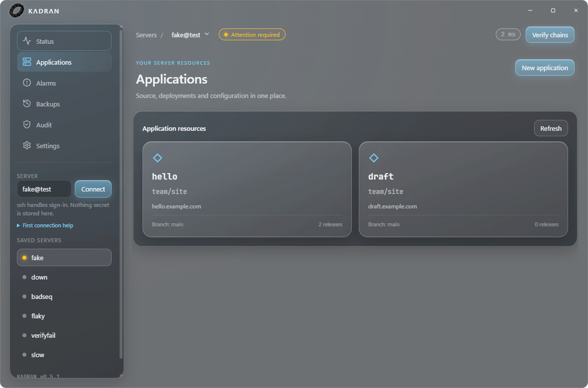
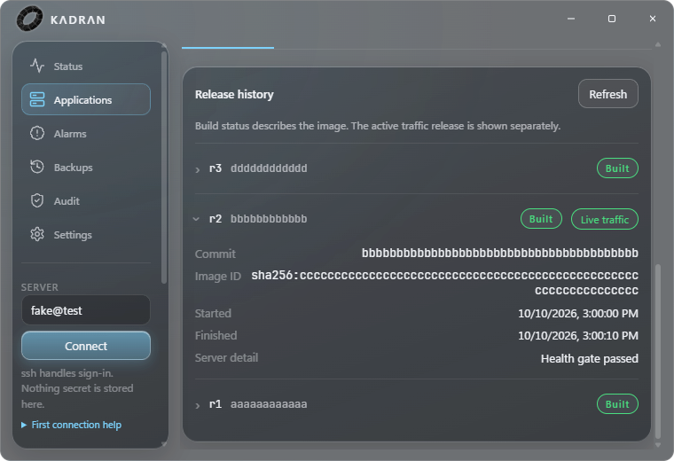
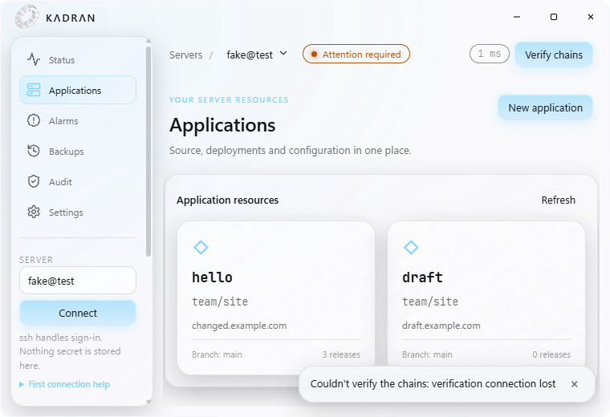

# Kadran: yapılan düzeltmeler ve doğrulama

Başlangıç commit'i: `90a6c55161e64767b88606c8af152b402e05c7e0`.
Tarih: 11 Ekim 2026. Kararlar: [K-143–K-147](../decisions.md).

## Yapılanlar

| Önceki sorun | Uygulanan davranış |
|---|---|
| Ham Caddy admin JSON'u dosya okuyan placeholder'a ulaşabiliyordu | Ayrı kimlikte tipli broker; sabit yapılandırma, strict DTO ve Unix erişim sınırı |
| Deploy/rollback/heal yarışları aktif sürümü etkileyebiliyordu | Ortak uygulama kuyruğu, iptal ve tüm rollout/drain boyunca koordinasyon |
| Atlanan rota veya hata başarı gibi dönebiliyordu | Kendi rota hatası başarısız; bilinen mevcut domain'in doğrulanmış rotası korunur |
| Yarım veya takılan HTTP gövdesi sağlıklı sayılabiliyordu | Tamamlanmış, en fazla 4 KiB gövde ve deadline zorunlu |
| Veritabanı hatası silme işleminde aktif sürüm yok gibi yorumlanıyordu | Beklenmeyen lookup hatasında sıfır executor işlemi |
| Başarısız audit isteği eski yeşili bırakabiliyordu | Eski doğrulama temizlenir; zaman ve bayatlık görünür |
| UTF-8 parçası, yanlış JSON şekli, erken işlem timeout'u | Akış decoder, sonuç doğrulama ve bağlantı dahil zaman bütçesi |
| Masaüstü yalnız durum/denetim ekranıydı | Uygulamalar, tanım düzenleme, sürümler, deploy/rollback, logs, alarm ve yedek yönetimi |
| Gizli ENV yer tutucusunu kaydetmek sırrı silebiliyordu | Dokunulmayan alan korunur; değiştirme/silme açık kullanıcı niyeti gerektirir |
| Özel GitHub deposu için güvenli build yolu yoktu | Opt-in root credential, repo allowlist, tam SHA ve sınırlı arşiv doğrulaması |
| Tarama erişilebilir bağımlılık açıkları gösteriyordu | Go 1.26.9, Caddy 2.11.7 ve uyumlu yamalı bağımlılıklar |

Coolify'dan esinlenen kaynak düzeni Kadran'ın saydam cam arayüzüyle uygulandı.
Orijinal torus PNG'si README, uygulama başlığı ve Windows ikonuna eklendi.
PNG SHA-256: `cf247a056c7d877055bc4aa8e7d9d7997f7971ff25f3affb89ec35e2bacbfc18`.
ICO üretimi ve lisans/provenance [desktop/assets](../../desktop/assets/README.md) altında.

## Yerel kanıt

| Kontrol | Sonuç |
|---|---|
| Windows, Go 1.26.9: `go test -race -count=1 ./...` | Geçti |
| Ubuntu 24.04 root, Go 1.26.9, gerçek kasa araçları/sudo zorunlu: aynı yarış testi | Geçti |
| `go vet ./...`, `buf lint`, golangci-lint | Geçti; lint 0 sorun |
| Caddy ayrı modül: `go test -race -count=1 ./...` | Windows ve Linux geçti; Linux amd64 ikilisi de derlendi |
| İki modülde `govulncheck ./...` | 0 erişilebilir, 0 import edilen paket; 1 kullanım dışı modül notu |
| `go run ./tools/thirdparty -check` | 151 modül + standart kütüphane lisansı bulundu |
| Yetkili kod/import graph kapısı | 2876/2900 satır; 11 paket |
| Masaüstü `npm test` | 168/168; atlanan test yok |
| `npm run typecheck`, build, `npm run test:built` | Geçti; 4/4 derlenmiş çıktı testi |
| `npm audit` | 0 bulgu |
| `scripts/mutate-desktop.sh` | 26/26 mutant yakalandı |
| Proxy broker mutasyonları | 6/6 mutant yakalandı |
| Tracked shell `bash -n` | 53 betik geçti |
| Bildirim, offsite, install/root, göç ve executor yüzeyi kontrolleri | Geçti |
| Gerçek Electron, sentetik sidecar; Solid ve Clear yönetim yolculuğu | Başarı/hata akışları ve 760×520 taşma kontrolü geçti |

Clear modunda büyük pencerede 918457 saydam piksel, küçük tanım ekranında
394474 ve sürüm ekranında 393534 saydam piksel ölçüldü. Saydam pencere ve
gerçek `backdrop-filter: blur(24px)` doğrulandı. Ekran kanıtları aşağıdadır;
görünen sunucu/uygulama verileri test fixture'ıdır.

## Kullanım ve yükseltme

[Masaüstü](../guides/desktop.md), [operasyonlar](../guides/operations.md),
[güvenlik yükseltmesi](../guides/quality-upgrade.md) ve
[özel GitHub depoları](../guides/private-git.md) rehberleri eklendi.
README/SECURITY/CHANGELOG aynı uygulanmış davranışı anlatır.

GitHub main'e yalnız kullanıcının ayrıca istediği logo/README değişikliği
`138b7ccccca66ce1250c349f88664c4818581d93` olarak gönderildi. Genel geliştirme
paketi bu çalışma kapsamında yereldir; canlı sunucu yükseltilmedi.

## Doğrulama sınırı

Bu kayıt bağımsız bir 8,5/10 puan veya üretim güvenliği sertifikası değildir.
Canlı SSH/Docker dağıtımı, gerçek token ile özel depo, yeni broker'a canlı
yükseltme, macOS/Linux cam görünümü, imza ve otomatik güncelleme doğrulanmadı.
SQLite yedeği ile hacim yedeği tek atomik uygulama snapshot'ı değildir.
Kullanım dışı OpenPGP uyarısı modül grafiğinde kalır; kullanılan paketler bunu
import etmez. Domain değiştirilirken eski domain rotasına sahiplik garantisi
verilmez. Yetkili kodun büyümesi K-146'da açıkça kaydedildi.

## Teslim kaydı

- Değişiklikler temiz `masaustu-temel` dalına fast-forward ile aktarıldı;
  kullanıcının proje klasörü `C:/Users/erkanrzgc/Desktop/kadran`.
- İmzasız Windows x64 paketi: `desktop/dist/Kadran-win32-x64/Kadran.exe`.
  Paket, test edilen uygulama commit'i `00260b3ff1e6` ve
  `v0.5.1-70-g00260b3` sidecar damgasıyla üretildi; sonraki teslim kaydı
  commit'i yalnız dokümantasyon/CI değişiklikleri içerir.
- Paket asıl klasöre kopyalandı ve burada Node bulunmayan PATH ile tekrar açıldı:
  pencere yüklendi, beklenen IPC köprüsü mevcut, renderer'a Node sızmıyor.
- `app.asar` 48 girdi içeriyor, `node_modules` girdisi 0; özgün logo renderer
  çıktısına kopyalanmış. Paketlenen `Kadran.exe` ikon kaynağı çıkarılıp görsel
  olarak kontrol edildi: kullanıcının torus simgesi mevcut.
- Caddy 2.11.7 ayrı modülünün hem Windows hem Linux yarış testi geçti. Linux
  amd64 derlemesi tamamlandı. CI artık iki Go modülünü ayrı güvenlik tarar;
  bu yeni CI düzeni uzak runner'da çalıştırılmadı.
